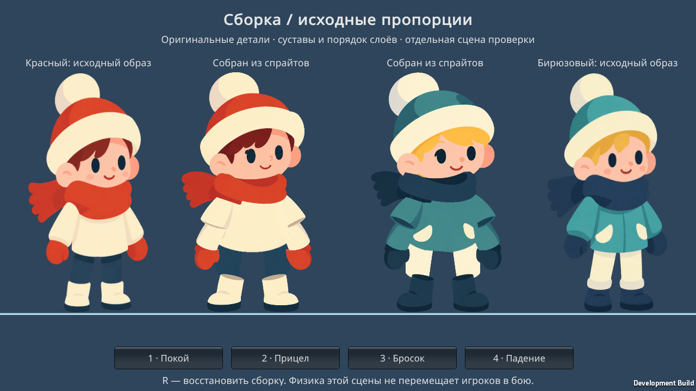
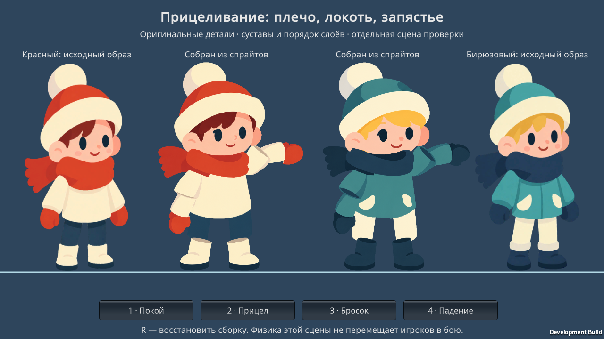
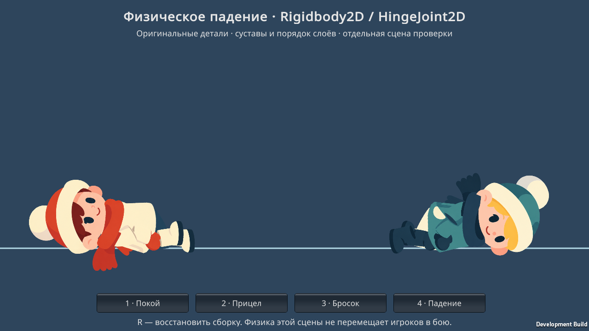
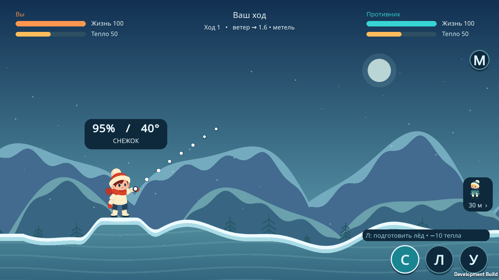

# Персонажи из исходных PNG — 0.4.0

Подготовлено 29 октября 2026 года. Unity 6000.3.10f1.

## Готовые ассеты

- `Assets/Resources/Characters/RedCharacter.prefab` — красный персонаж, 14 спрайтов.
- `Assets/Resources/Characters/TealCharacter.prefab` — бирюзовый персонаж, 16 спрайтов.
- `Assets/Art/Characters/red/` и `teal/` — отдельные PNG со сглаженной прозрачностью. Импорт: Sprite (Single), 400 pixels per unit, Full Rect, Bilinear, без mipmaps и потерь от сжатия. Pivots записаны в `.meta`.
- `Assets/Scenes/CharacterWorkshop.unity` — открыть и нажать Play для сравнения, прицеливания, броска и физического падения. Кнопки внизу либо клавиши 1–4; R восстанавливает сборку.
- `ArtSource/Characters/` — четыре предоставленных пользователем оригинала, без изменения.
- `Tools/prepare_characters.py` — воспроизводимая очистка и нарезка (Pillow, NumPy, SciPy). Затем меню **Frost Duel → Characters → Build sprites and prefabs** пересоздаёт импорт и префабы. Для обычного использования это не требуется: всё уже сохранено.

Ручная нарезка, расстановка pivots или сборка в Sprite Editor не нужны. Персонажи также используются в основном игровом экране, меню и указателе противника через `CharacterPortrait`. Правила, канонические хитбоксы головы/тела, неподвижные позиции и Bluetooth-состояние не изменены.

## Что подготовлено и исправлено

Из каждого листа выделены голова с шапкой, корпус, два верхних рукава, два предплечья, две варежки, две части брюк и два сапога. Предплечья и варежки разделены по границе материала. Шарф разделён на задний слой и передний воротник: хвост не перекрывает корпус и двигается с шарфом. Два кармана бирюзовой куртки, отсутствующие на листе деталей, извлечены из его полноразмерного изображения.

Случайные альфа-островки и тонкие белые выбросы удалены по связным областям. RGB внутри деталей сохранён; меняется маска краёв. Вокруг каждого спрайта оставлено прозрачное поле. Автоматический аудит всех **30 PNG** подтвердил один связный видимый компонент, прозрачные поля и отсутствие цветовых значений при нулевой альфе. Генеративная проба не использована: после явного выбора пользователя итог получен точной обработкой исходных пикселей.

Точки плеч размещены в верхних закруглённых частях рукавов, локти и запястья — на стыках с перекрытием, шея — у основания головы, таз — внутри корпуса, колени — в верхних срезах сапог. Наклон исходного рисунка рукавов компенсирован поворотом визуального слоя, независимо от оси сустава. Верхний рукав перекрывает край предплечья, предплечье — край варежки; сапоги перекрывают концы брюк. Исправлены высота корпуса, длина видимой части ног, положение шарфа и расстояние между ступнями.

Листы деталей и полноразмерные рисунки не полностью идентичны: отличаются оттенки куртки, форма чёлки, щёки и некоторые складки. Сборка сохраняет рисунок предоставленных деталей; лица не перерисованы для искусственного пиксельного совпадения. Сравнение ниже показывает фактический результат.

## Движение и физика

`CutoutCharacter.Pose` управляет шеей, шарфом, плечами, локтями и запястьями. Рука достигает точки выпуска снаряда двухзвенной IK. Для обычного отображения Rigidbody2D имеют `simulated = false`: физика не сдвигает персонажа и не вмешивается в расчёт попаданий.

`Fall` включает **12 Rigidbody2D и 11 HingeJoint2D** на персонажа. Коллайдеры частей не сталкиваются друг с другом; столкновение с внешней поверхностью включено. На время падения физические части выводятся из вложенной иерархии, сохраняя мировые положения. `ResetPose` возвращает исходных родителей и локальные трансформации. Шарф остаётся визуальным слоем на корпусе, а не отдельной физической тканью.

**Падение доступно в тестовой сцене. Оно не добавлено как новая механика снежной дуэли.**

## Фактически выполнено

- 30 PNG: аудит связности альфы, прозрачных полей и очистки внешних пикселей.
- Графический Unity Linux Player: **26 проверок** обеих сборок. Проверено, что рука действительно меняет положение при прицеливании; при углах 5°…85° точки плеча/локтя/запястья не расходятся. Просмотрены покой с небольшим движением головы и шарфа, прицел, замах, выпуск и возврат.
- Для обоих персонажей: реальная динамическая симуляция падения с подъёма 0,65 мировой единицы и противоположными горизонтальными импульсами на плоский BoxCollider2D. Проверены наклон корпуса более 20°, приземление, конечность координат, расстояние между якорями шарниров менее 0,06, затухание скоростей ниже 0,5 единицы/с через 7 секунд и восстановление иерархии после падения.
- Повторно пройдены 212 проверок правил, протокола, прицела и зеркального представления. В игровом Unity Player пройдены 196 проверок двух координаторов; внешний вид заменён, расхождение прогноза и авторитетного полёта осталось 0.
- Linux Player и Android APK 0.4.0 собраны. Физическое падение проверено в Linux Player, не на Android-телефоне. Ходьба, прыжки, физическая ткань шарфа и падение на произвольном разрушаемом рельефе не реализованы/не проверялись.

Открытый пользовательский Unity Editor не закрывался. Сборки выполнялись в отдельной временной копии, готовые ассеты и префабы перенесены в `project`.

## Снимки Unity Player

Слева/справа — полноразмерные исходные образы; в центре — два собранных префаба:



Прицеливание с соединёнными плечом, локтем и запястьем:



Физическое падение после затухания:



Основной игровой экран:



## Повторение проверки

Из папки проекта после Linux-сборки:

```bash
./Builds/Linux/FrostDuel -screen-fullscreen 0 -screen-width 1280 -screen-height 720 \
  -captureCharacters -logFile Builds/Logs/characters-runtime.log
```

Отчёт и снимки: `Builds/CharacterVerification/`. При сбое создаётся `FAILED.txt`, Player завершается с кодом 1. Обычная интерактивная мастерская запускается аргументом `-characterWorkshop` либо сценой `CharacterWorkshop` в Editor. APK: `Builds/FrostDuel.apk`, одинаковую версию следует установить на оба телефона.
