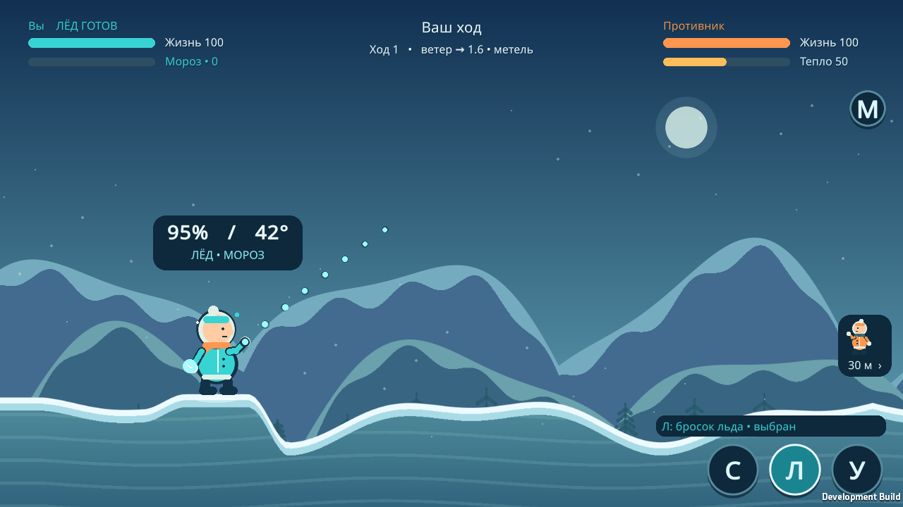
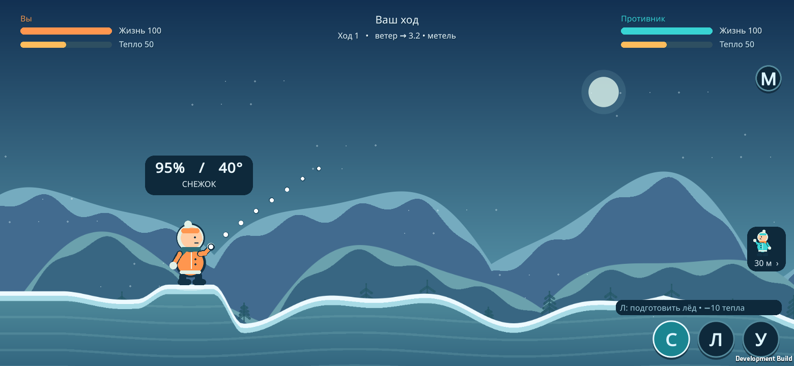
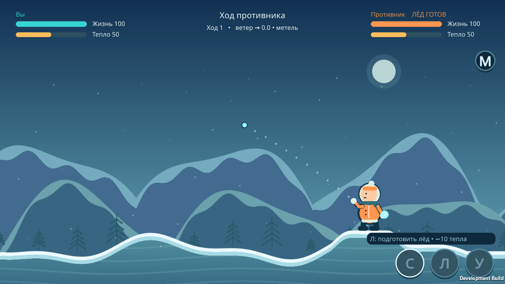
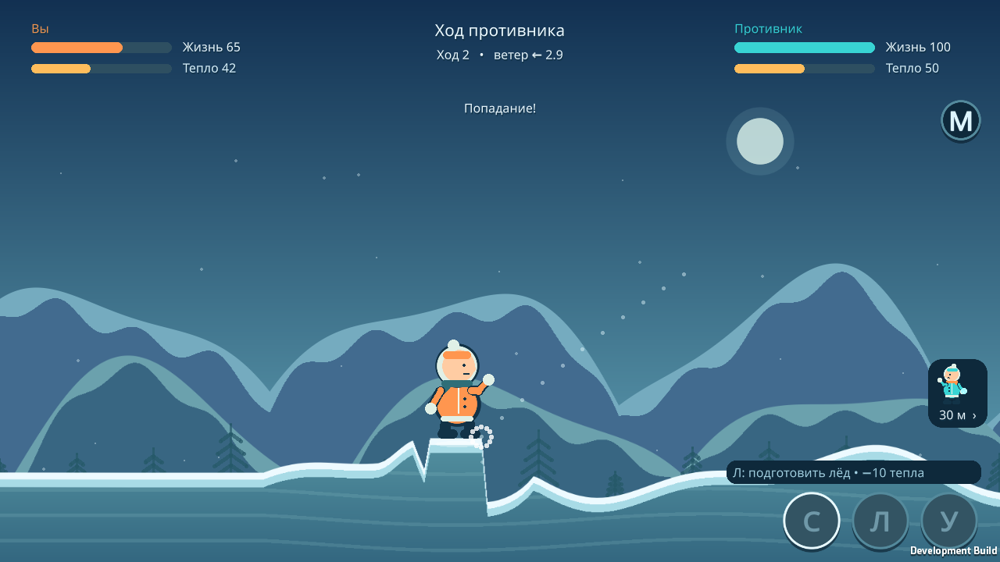

# Своё представление, короткий прицел и камера — 0.3.0

29 октября 2026. Unity 6000.3.10f1, Linux Player и Android IL2CPP ARM64 + ARMv7. Все снимки ниже получены из работающего Unity Player.

## Что изменено

На обоих телефонах свой персонаж находится слева и смотрит вправо. Подключившийся игрок видит зеркало канонической карты: `viewX = worldWidth − worldX`. Цвет персонажа сохраняет его сетевую идентичность. На HUD теперь «Вы» / «Противник»; ветер и снежинки отражаются вместе с миром. Текстура земли с воронками отражается по UV. Попадания, неподвижные позиции, массив высот, JSON-действия и результат ведущего продолжают использовать общие мировые координаты.

Ширина карты увеличена с 32 до 38 единиц. Фиксированные позиции — x=4 и x=34, расстояние 30 вместо 24. Урон, тепло, лёд, ветер, скорость снарядов, опоры и правила ходов не изменены. Камера показывает своего персонажа примерно на четверти ширины экрана; противник обычно вне кадра. Указатель справа содержит его миниатюру и расстояние и исчезает, когда персонаж виден.

На любом телефоне жест одинаковый: коснуться свободного поля, потянуть влево и вниз, отпустить. Дуга показывает только первые **до 4,5 единицы пути и до 0,65 секунды полёта** — берётся более короткий предел. Она начинается в той же точке выпуска и использует тот же расчёт снаряда, ветра и фазы мороза, что и ведущий. Линия жеста и маркеры пальца удалены. Сила и угол остаются в отдельном компактном окне.

При попадании пальца в область собственного персонажа `MoveAim` немедленно отменяет жест; `EndAim` дополнительно проверяет эту область. Сдвиг пальца обратно и отпускание после отмены не отправляют действие. Для повторной попытки требуется новое начало касания. Сохранены остальные способы отмены и блокировка UI, чужого хода, паузы и обработки результата.

После броска камера экспоненциально сглаживает перемещение к текущему положению снаряда, не анализируя будущую траекторию. Это работает также для входящего броска. На паузе попадания отображается уже рассчитанный результат: здоровье, тепло, лёд и рельеф. При этом координатор ещё заблокирован. После завершения анимации камера возвращается к своему персонажу; управление включается после её возвращения.

Убраны нижняя левая подсказка и большие подложки показателей/хода. Надписи с тенью читаются на фоне неба. Кнопки **С / Л / У / М** сохранены; подсказка «Л» различает подготовку, готовность и выбранный лёд. Фон продлён вниз, чтобы при высоком полёте не появлялся прямоугольный обрыв изображения гор. Новые художественные ассеты и механики не добавлялись.

## Выполненные проверки

- Unity Editor batchmode: **212 утверждений** — 35 правил (включая 5 матчей / 45 ходов), 10 протокола, 70 прицела, 97 представления/камеры.
- Для двух владельцев и логических ширин 1100 / 1280 / 1560: свой персонаж слева, противник справа вне кадра, прямое/обратное преобразование всех отсчётов рельефа после воронки, знак ветра, короткий начальный прогноз, сопровождение исходящих/входящих снега и льда, возврат камеры. Преобразование не меняет состояние матча.
- 24 комбинации стороны, снаряда, ветра −3,2 / 0 / +3,2 и тепла 0 / 50: прогноз совпадает с авторитетным результатом после JSON-передачи. Максимальное расхождение точек — **0**. Проверены влияние метели, меньший снос льда и плавный мороз до ±2°.
- Графический Unity Player: **196 утверждений**. Использованы два настоящих `SessionCoordinator`, handshake, сериализованные команды и результаты; радиоканал заменён очередью JSON-пакетов.
- Восемь исходящих бросков: владелец ведущего/клиента × снег/лёд × тепло 50/0, ветер ±1,6 и метель. Проверены короткая дуга у руки, одинаковый жест, отмена при наведении и отпускании на себе, запрет броска после отмены, новый жест, четыре кнопки UI, полёт за пределами исходного кадра, пауза результата, возврат камеры, неизменная идентичность владельца и блокировка чужого хода. Расхождение прогноза и фактического пути — **0**.
- Два входящих попадания льдом: скрытие указателя при видимом противнике, сопровождение, показ урона до возврата камеры, совпадение конечных состояний, возможность следующего хода у получателя.
- Дополнительно: отмена возвратом к началу, явная отмена, отпускание над UI и за полем, блокировка меню, сброс выбора льда в новом матче; широкий экран 1560×720 с зеркальным видом клиента.
- Визуально просмотрены прицелы ведущего и клиента, мороз/лёд, полёт, входящий бросок, попадание и возврат. Linux Player и Android APK собраны успешно, без ошибок и предупреждений сборки. Подпись, версия и разрешения APK проверены инструментами Android SDK.
- `adb devices`: подключённых Android-телефонов нет. Физические жесты пальцем, Bluetooth-радиосвязь двух телефонов и производительность на них **не проверены**. Runtime-тесты вызывают общие обработчики жеста программно, не подменяют проверку Android-сенсора.

## Снимки

Ведущий, лёд при нулевом тепле:



Подключившийся игрок, широкий экран: собственный оранжевый персонаж слева, ветер отражён, противник за кадром:



Входящий снаряд: противник виден, указатель скрыт:



Результат попадания до возвращения камеры:



## Воспроизведение

Из Unity: **Frost Duel → Build Android APK**. Локальный APK: `Builds/FrostDuel.apk`, версия 0.3.0 / code 3, отладочная подпись. Установить одинаковую сборку на оба телефона. APK, кэш, логи и промежуточные результаты исключены из Git. SHA-256 APK: `6f6441597d750f0ae3e40c6c4f66143de73f35f45bf319932263caae1e314088`.

```bash
Unity -batchmode -nographics -quit -projectPath /absolute/path/project \
  -buildTarget Linux64 -executeMethod FrostDuel.Editor.ProjectBuilder.VerifyAndLinux \
  -logFile /absolute/path/project/Builds/Logs/verify.log
```

Затем из папки `project`:

```bash
./Builds/Linux/FrostDuel -screen-fullscreen 0 -screen-width 1280 -screen-height 720 \
  -capturePreview -logFile Builds/Logs/runtime.log
```

Отчёты находятся в `Builds/{core,protocol,aim,view}-verification.txt` и `Builds/VisualVerification-v03/runtime-verification.txt`. При ошибке runtime-тест создаёт `FAILED.txt` и завершает Player с кодом 1. При новом запуске этот файл удаляется. Для версии 0.3 в репозиторий включены только четыре отобранных снимка выше.
