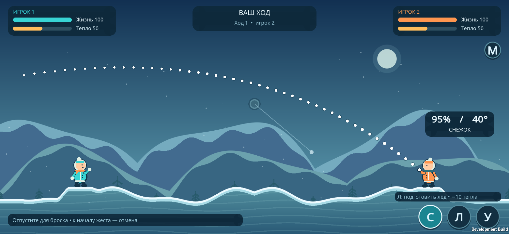
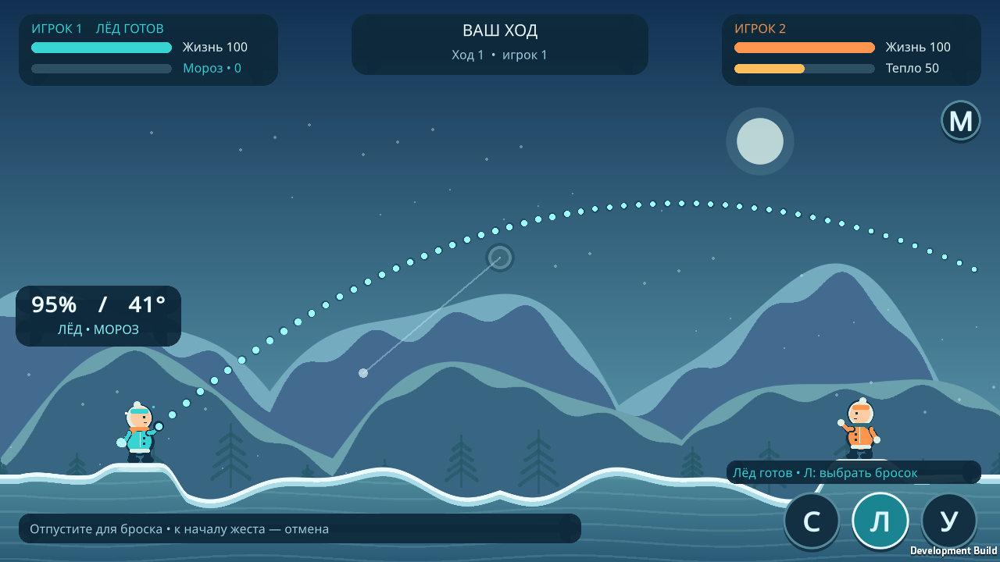
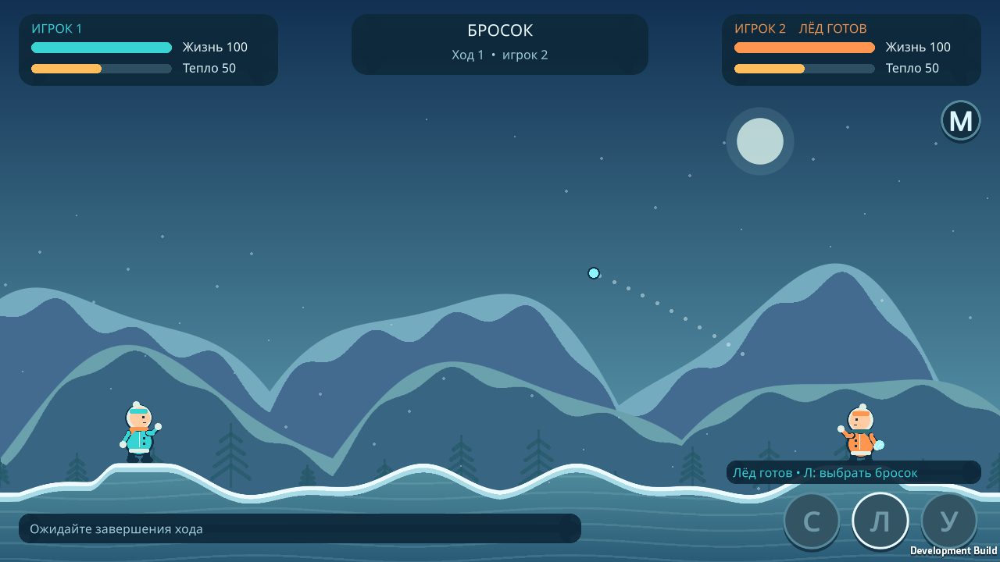

# Графика и прицеливание — 0.2.0

Исторический отчёт. Актуальное управление и проверки версии 0.3.0: [OWNER_VIEW.md](OWNER_VIEW.md).

Проверено 29 октября 2026 года. Проект: Unity 6000.3.10f1. Исходная пояснительная записка не менялась.

## Изменения

- Оттягивание назад относительно стороны игрока: слева — влево вниз, справа — вправо вниз. Управление использует одну логическую систему координат с учётом safe area; широкий экран заполняется по всей доступной ширине.
- Дуга начинается в `Projectile.ReleasePoint`, там же, где фактический снаряд. Прогноз вызывает тот же `Projectile.Simulate`, что и ведущий. Учитываются тип снаряда, ветер, метель, столкновения и мороз. Отдельной формулы «примерной параболы» нет.
- Перемещение жеста сглаживается. При отпускании отправляются параметры последней показанной дуги. На морозе фазу плавного дрожания получает и ведущий; по умолчанию амплитуда ±2°, без дрожания при положительном тепле. Для высокого броска масштаб поля плавно уменьшается, сохраняя видимость дуги.
- Отмена: возврат к месту начального касания, отпускание за полем / над UI, второй палец, Escape или правая кнопка мыши в редакторе/desktop. При отмене действие не отправляется и ход не тратится.
- Верхние показатели, кнопки, персонажи и модальные окна исключены из зон начала прицеливания. На ходе соперника, при паузе и обработке результата прицеливание блокируется.
- Вместо прямоугольных столбцов земли используется кэшируемая процедурная текстура с непрерывной интерполяцией массива высот и сглаженным краем. Переходы к площадкам сглажены также в самой геометрии, чтобы отображение и попадания соответствовали друг другу. Воронки и опоры остаются частью синхронизируемого рельефа.
- Капюшоны, лица, куртки, шарфы, руки, варежки и ботинки собраны из окружностей, эллипсов и отрезков. Снег, многослойные горы и деревья также создаются средствами Unity. Графика Bowmasters не использовалась.
- Широкой нижней панели нет. Кнопки содержат ровно одну букву: **С**, **Л**, **У**, **М**. Состояние и подсказка «Л» показывают подготовку / готовность льда; недоступные действия затемнены. Подсказка силы размещается позади персонажа и не перекрывает дугу.
- Урон, затраты/восстановление тепла, смена ходов, сбивание подготовки, воронки и Bluetooth Classic сохранены. Сетевой протокол теперь версии 2: к параметрам броска добавлена фаза мороза. **Новый APK необходимо установить на оба телефона**; смешанные версии отклоняются при соединении.

## Только выполненные проверки

| Проверка | Результат |
|---|---|
| Компиляция Unity 6000.3.10f1, сборка Linux Player | Успешно |
| 35 проверок правил, включая пять матчей (45 ходов) | Пройдены |
| 10 проверок двух координаторов с сериализованными сообщениями: подтверждения, повторы, разрыв/восстановление | Пройдены; это проверка протокола, не радиосвязи |
| 70 проверок прицела: зеркальный жест, отмена, преобразование координат, сила ветра/метели, мороз | Пройдены |
| 24 комбинации «сторона × снаряд × ветер × тепло», прогноз против ведущего после JSON-передачи действия | Максимальная ошибка всех точек — 0 мировых единиц |
| Фаза мороза: 600 отсчётов при 60 Гц | Амплитуда не более 2°; изменение за отсчёт менее 0,08°; при тепле > 0 ошибка угла равна 0 |
| Графический запуск Unity Linux Player: 89 утверждений | Пройдены |
| Восемь бросков через общие обработчики ввода: обе стороны, снег/лёд, тепло 50/0, ветер ±3,2 и метель | Показанный прогноз совпал с реальной анимацией по всем точкам, ошибка 0 |
| Касания четырёх кнопок, отпускание на UI/за полем, возврат к началу, явная отмена, меню, чужой ход, обработка результата | Проверены в runtime; нежелательный бросок не отправляется |
| Смена матча с тем же номером хода | Проверен сброс старого выбора снаряда |
| Координаты с safe area: 1280×720, 1920×1080, 2340×1080 | Прямое/обратное преобразование с ошибкой < 0,001 логического пикселя |
| Графический широкий экран 1560×720 (19,5:9) | Проверены размещение кнопок и траектория справа; снимок ниже |
| Android APK 0.2.0, IL2CPP ARM64 + ARMv7 | Сборка успешна: 0 ошибок / 0 предупреждений; подпись APK подтверждена `apksigner`, версия и разрешения — `aapt` |
| Android по USB (`adb devices`) | Подключённых устройств нет |

Runtime-проверки программно вызывают те же методы `BeginAim`, `MoveAim`, `EndAim`, что используются пальцем/мышью. Они не доказывают работу драйвера сенсорного экрана на Android. Физический жест пальцем, радиосвязь и производительность на телефонах в этой итерации **не проверены**.

Визуально просмотрены меню, дуга слева, дуга справа на широком экране, лёд при нулевом тепле и полёт льда. Снимки сняты из работающего Unity Player, не нарисованы отдельно.

## Снимки

Снежок, правый игрок, широкий экран:



Лёд при нулевом тепле, левый игрок:



Полёт льда справа; действия заблокированы:



## APK

Локальный файл: `Builds/FrostDuel.apk` (отладочная подпись, установка на оба устройства). SHA-256: `98d9f3b884d480f51a0b5a7b1b8de0d40a506d7210654f9b57b1d3b168fdf576`. APK не добавлен в Git. Сборка: **Frost Duel → Build Android APK**.

## Повторение

В меню Unity: **Frost Duel → Run core verification**, **Frost Duel → Run protocol verification**. Все три набора проверок и Linux-сборка запускаются командой:

```bash
Unity -batchmode -nographics -quit -projectPath /absolute/path/project \
  -buildTarget Linux64 -executeMethod FrostDuel.Editor.ProjectBuilder.VerifyAndLinux \
  -logFile /absolute/path/project/Builds/Logs/verify.log
```

Затем из папки проекта:

```bash
./Builds/Linux/FrostDuel -screen-fullscreen 0 -screen-width 1280 -screen-height 720 \
  -capturePreview -logFile Builds/Logs/runtime.log
```

Локальные результаты: `Builds/aim-verification.txt`, `Builds/core-verification.txt`, `Builds/protocol-verification.txt`, `Builds/VisualVerification/runtime-verification.txt`, изображения `Builds/VisualVerification/` и логи `Builds/Logs/`. Они исключены из Git; в репозитории оставлены только три отобранных изображения для документации.
